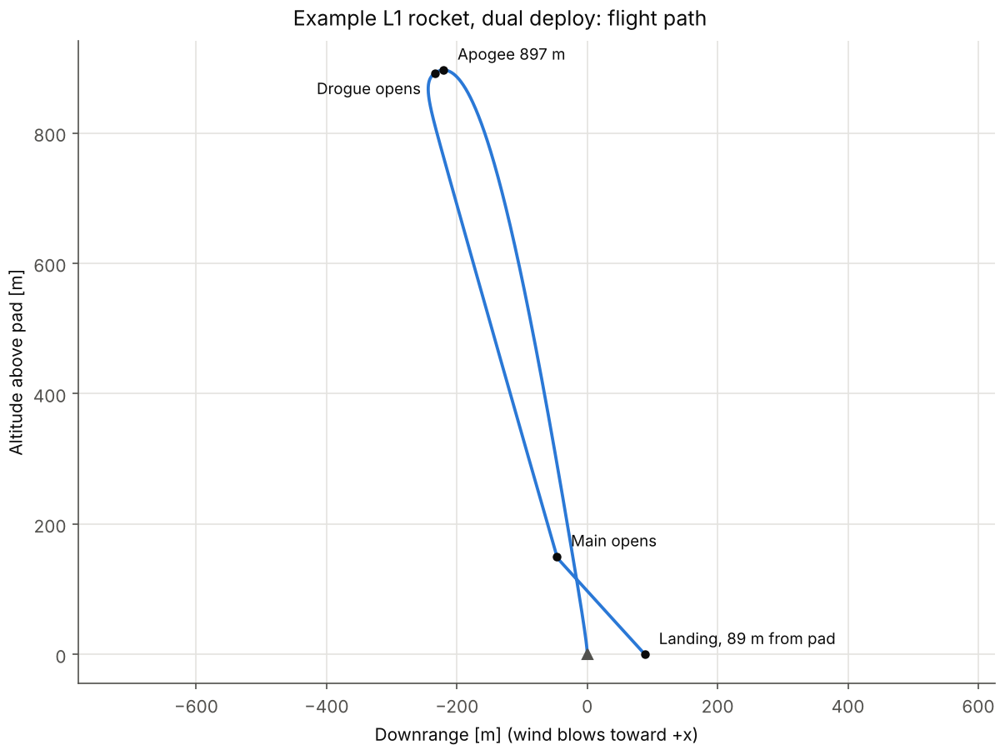

# apogee

[](https://github.com/aroni06/rocket-project/actions/workflows/ci.yml)


**A 2D rocket flight simulator for model and high-power rockets, written in Python.** From a
rocket definition, a motor thrust curve and its parachutes, it predicts apogee, max velocity,
acceleration and dynamic pressure, rail exit speed, parachute deployment conditions, landing
speed and wind drift.

> **Status: work in progress.** The flight model and parachute recovery (milestones 1 to 3) are
> done and checked against closed-form solutions. Stability (Barrowman), OpenRocket validation
> and the design optimizer are next; see the [roadmap](#roadmap).




*Example L1 rocket on a synthetic 38 mm H motor, flown dual deploy in a 4 m/s wind: a 0.3 m
drogue opens 1 s after apogee and a 0.9 m main opens at 150 m.*

## Quickstart

```bash
git clone https://github.com/aroni06/rocket-project.git
cd rocket-project
pip install -e ".[dev]"

apogee simulate configs/example_dual_deploy.toml --plot flight.png --trajectory path.png
pytest
```

```
Motor: Synthetic_H250 (H, 260.8 N s, 1.32 s burn)
Flight summary: Example L1 rocket, dual deploy
  Apogee                                   896.58 m
  Max speed                                170.48 m/s
  Max ascent acceleration                   17.83 g
  Rail exit speed                           24.24 m/s
  Drogue descent rate                       13.88 m/s
  Main deploy altitude                     150.00 m
  Main opening load (upper bound)            8.88 g
  Landing descent rate                       4.38 m/s
  Landing downrange                         88.62 m
  ...
```

Rockets are defined in TOML: a [single-deploy example](configs/example_l1.toml) using the
motor's ejection charge, and a [dual-deploy example](configs/example_dual_deploy.toml). Each
parachute opens on a trigger plus an optional delay: `apogee`, descending through a set
`altitude`, or `burnout` (a motor ejection delay). Motors are RASP `.eng`
files, the format published by [thrustcurve.org](https://www.thrustcurve.org). The bundled
`Synthetic_H250.eng` is a made-up curve so the example runs out of the box; download a real
`.eng` for real predictions.

From Python:

```python
from apogee import load_config, simulate

cfg = load_config("configs/example_l1.toml")
result = simulate(cfg.rocket, cfg.environment, cfg.rail)
print(result.apogee, result.rail_exit_speed, result.landing_descent_rate)
```

## Model

State `y = [x, z, vx, vz]` in a flat-Earth ground frame (x downrange, z above the pad). Mass is a
known function of time from the motor, so it is not integrated.

$$
m(t)\,\dot{\mathbf v} = T(t)\,\hat{\mathbf u} \;-\; \tfrac12 \rho\, C_D(M)\, A\, |\mathbf v_{air}|\,\mathbf v_{air} \;+\; m\,\mathbf g(h),
\qquad \mathbf v_{air} = \mathbf v - \mathbf v_{wind}
$$

| Piece | Model |
| --- | --- |
| Thrust | RASP thrust curve, linear interpolation |
| Mass | Propellant burns in proportion to delivered impulse: m_p(t) = m_p0 (1 - I(t) / I_total) |
| Atmosphere | 1976 U.S. Standard Atmosphere, 0 to 32 km, launch-site elevation and temperature offset |
| Drag | Constant C_D or any function C_D(Mach) |
| Gravity | Inverse-square, g = g0 (R / (R + h))^2 |
| Attitude | Along the rail until rail exit, then along the air-relative velocity (zero angle of attack) |
| Wind | Constant horizontal wind |
| Parachutes | Drag 1/2 rho v^2 Cd A per canopy against the air-relative velocity; triggered at apogee, at an altitude, or by motor ejection delay; drogues stay attached after the main opens |

The flight is integrated phase by phase with SciPy's `solve_ivp` (DOP853, adaptive step), and
every discontinuity lands on a step boundary: each thrust-curve corner, rail exit, burnout,
apogee and parachute deployment. Rail exit, apogee, deployment altitudes, landing and the speed
peak are located exactly with event functions rather than read off the nearest time step.

**Deliberately not modelled:** rotational (6-DOF) dynamics, weathercocking on the rail, wind
profiles and gusts, Earth rotation, multi-stage vehicles.

**Known limitations:**

- Parachutes inflate instantly, so the reported opening load is an upper bound on the real
  opening shock.
- The rocket turns into the relative wind the moment it leaves the rail. A real rocket has
  rotational inertia and turns more slowly, so the model overpredicts how far upwind it flies in
  a crosswind (220 m upwind at apogee in the example). OpenRocket comparisons will quantify this.

## Verification

The test suite (`pytest`, run in CI on every push) checks the simulator against cases with a
closed-form answer:

| Case | Compared quantity | Tolerance |
| --- | --- | --- |
| Constant thrust in vacuum | Rail exit time and speed, burnout speed and altitude, apogee (rocket equation with gravity) | 1e-7 relative |
| Vertical coast with quadratic drag | Apogee, time to apogee, landing speed | 1e-7 relative |
| Drag-free projectile at 45 degrees | Range, apogee, landing speed | 1e-7 relative |
| Ballistic arc, inverse-square gravity | Specific energy conserved | 1e-8 relative |
| Solver tolerance 1e-6 vs 1e-11 | Apogee and max speed | 1e-5 relative |
| Standard atmosphere | T, p, rho at 0, 1, 5, 11 and 20 km vs 1976 tables | 1e-4 relative |
| Fall under a parachute from apogee | Landing descent rate vs the closed-form quadratic-drag solution | 1e-6 relative |
| Drogue, then drogue plus main | Steady descent rates vs terminal velocity sqrt(2mg / rho Cd A) | 1e-3 relative |
| Deployment triggers | Apogee + delay, set altitude, burnout + ejection delay | exact event times |
| Descent in wind | Horizontal speed under canopy settles at wind speed | 1e-3 relative |

Comparison against OpenRocket on real rocket designs comes with milestone 5.

## Project layout

```
src/apogee/
  atmosphere.py    standard atmosphere
  motor.py         .eng parser, thrust(t), mass(t)
  rocket.py        rocket definition
  environment.py   gravity, wind, launch site
  recovery.py      parachutes, deployment triggers, terminal velocity
  flight.py        equations of motion, phases, events, FlightResult
  config.py        TOML loader
  plots.py         standard flight plots
  cli.py           `apogee simulate`
configs/           example rockets
data/motors/       thrust curves
tests/             unit and analytic verification tests
```

## Roadmap

- [x] 1. Repo skeleton, packaging, CI
- [x] 2. Core 2D flight model with analytic verification
- [x] 3. Recovery: single and dual deploy, landing speed, wind drift
- [ ] 4. Aerodynamics and stability: C_D(Mach) import, Barrowman CP, CG, static margin
- [ ] 5. Validation against OpenRocket on 2 to 3 rockets
- [ ] 6. Parameter sweeps and constrained design optimizer
- [ ] 7. Technical report and v1.0

## License

MIT
