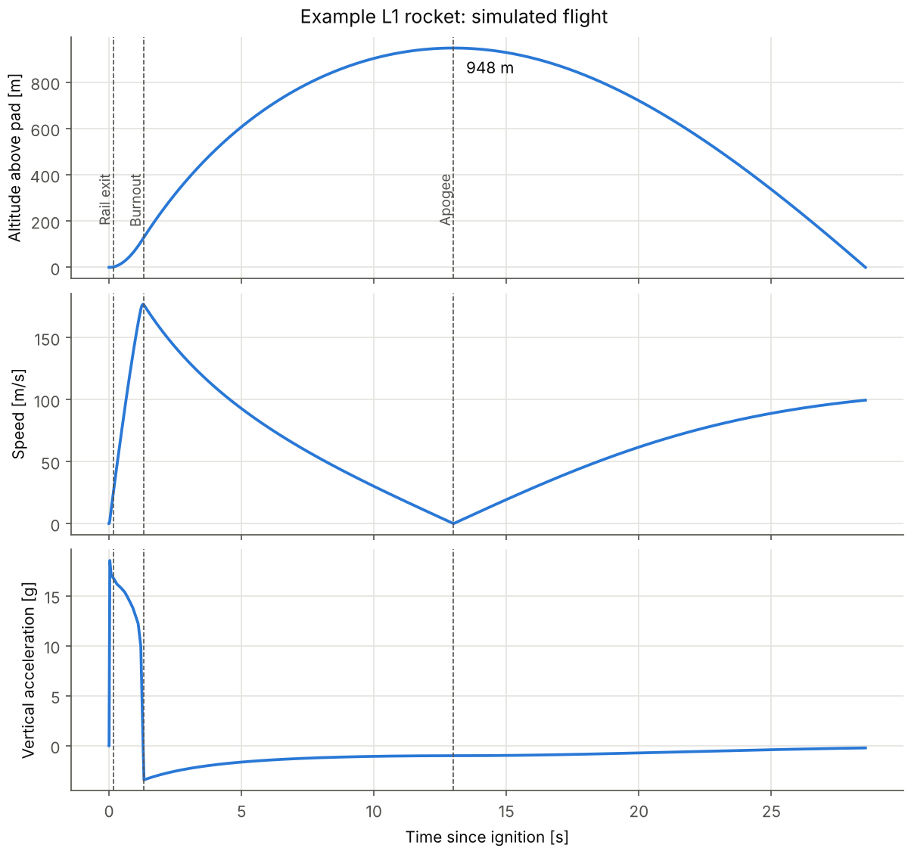

# apogee

**A 2D rocket flight simulator for model and high-power rockets, written in Python.** It
predicts apogee, max velocity, max acceleration, max dynamic pressure, rail exit speed and
landing conditions from a rocket definition and a real motor thrust curve.

> **Status: work in progress.** The core flight model (milestones 1 and 2) is done and checked
> against closed-form solutions. Parachute recovery, stability (Barrowman), OpenRocket validation
> and the design optimizer are next; see the [roadmap](#roadmap).



*Example L1 rocket on a synthetic 38 mm H motor. Descent is ballistic until the recovery model
lands in milestone 3.*

## Quickstart

```bash
git clone https://github.com/aroni06/rocket-project.git
cd rocket-project
pip install -e ".[dev]"

apogee simulate configs/example_l1.toml --plot flight.png --csv flight.csv
pytest
```

```
Motor: Synthetic_H250 (H, 260.8 N s, 1.32 s burn)
Flight summary: Example L1 rocket
  Apogee                     947.69 m
  Time to apogee              13.00 s
  Max speed                  176.99 m/s
  Max Mach                     0.52
  Max acceleration            18.52 g
  Rail exit speed             24.72 m/s
  ...
```

Rockets are defined in TOML ([example](configs/example_l1.toml)). Motors are RASP `.eng`
files, the format published by [thrustcurve.org](https://www.thrustcurve.org). The bundled
`Synthetic_H250.eng` is a made-up curve so the example runs out of the box; download a real
`.eng` for real predictions.

From Python:

```python
from apogee import load_config, simulate

cfg = load_config("configs/example_l1.toml")
result = simulate(cfg.rocket, cfg.environment, cfg.rail)
print(result.apogee, result.max_speed, result.rail_exit_speed)
```

## Model

State `y = [x, z, vx, vz]` in a flat-Earth ground frame (x downrange, z above the pad). Mass is a
known function of time from the motor, so it is not integrated.

$$
m(t)\,\dot{\mathbf v} = T(t)\,\hat{\mathbf u} \;-\; \tfrac12 \rho\, C_D(M)\, A\, |\mathbf v_{air}|\,\mathbf v_{air} \;+\; m\,\mathbf g(h),
\qquad \mathbf v_{air} = \mathbf v - \mathbf v_{wind}
$$

| Piece | Model |
| --- | --- |
| Thrust | RASP thrust curve, linear interpolation |
| Mass | Propellant burns in proportion to delivered impulse: m_p(t) = m_p0 (1 - I(t) / I_total) |
| Atmosphere | 1976 U.S. Standard Atmosphere, 0 to 32 km, launch-site elevation and temperature offset |
| Drag | Constant C_D or any function C_D(Mach) |
| Gravity | Inverse-square, g = g0 (R / (R + h))^2 |
| Attitude | Along the rail until rail exit, then along the air-relative velocity (zero angle of attack) |
| Wind | Constant horizontal wind |

The flight is integrated phase by phase with SciPy's `solve_ivp` (DOP853, adaptive step), and
every discontinuity lands on a step boundary: each thrust-curve corner, rail exit, burnout and
apogee. Rail exit, apogee, landing and the speed peak are located exactly with event functions
rather than read off the nearest time step.

**Deliberately not modelled:** rotational (6-DOF) dynamics, weathercocking on the rail, wind
profiles and gusts, Earth rotation, multi-stage vehicles.

## Verification

The test suite (`pytest`, run in CI on every push) checks the simulator against cases with a
closed-form answer:

| Case | Compared quantity | Tolerance |
| --- | --- | --- |
| Constant thrust in vacuum | Rail exit time and speed, burnout speed and altitude, apogee (rocket equation with gravity) | 1e-7 relative |
| Vertical coast with quadratic drag | Apogee, time to apogee, landing speed | 1e-7 relative |
| Drag-free projectile at 45 degrees | Range, apogee, landing speed | 1e-7 relative |
| Ballistic arc, inverse-square gravity | Specific energy conserved | 1e-8 relative |
| Solver tolerance 1e-6 vs 1e-11 | Apogee and max speed | 1e-5 relative |
| Standard atmosphere | T, p, rho at 0, 1, 5, 11 and 20 km vs 1976 tables | 1e-4 relative |

Comparison against OpenRocket on real rocket designs comes with milestone 5.

## Project layout

```
src/apogee/
  atmosphere.py    standard atmosphere
  motor.py         .eng parser, thrust(t), mass(t)
  rocket.py        rocket definition
  environment.py   gravity, wind, launch site
  flight.py        equations of motion, phases, events, FlightResult
  config.py        TOML loader
  plots.py         standard flight plots
  cli.py           `apogee simulate`
configs/           example rockets
data/motors/       thrust curves
tests/             unit and analytic verification tests
```

## Roadmap

- [x] 1. Repo skeleton, packaging, CI
- [x] 2. Core 2D flight model with analytic verification
- [ ] 3. Recovery: single and dual deploy, landing speed, wind drift
- [ ] 4. Aerodynamics and stability: C_D(Mach) import, Barrowman CP, CG, static margin
- [ ] 5. Validation against OpenRocket on 2 to 3 rockets
- [ ] 6. Parameter sweeps and constrained design optimizer
- [ ] 7. Technical report and v1.0

## License

MIT
