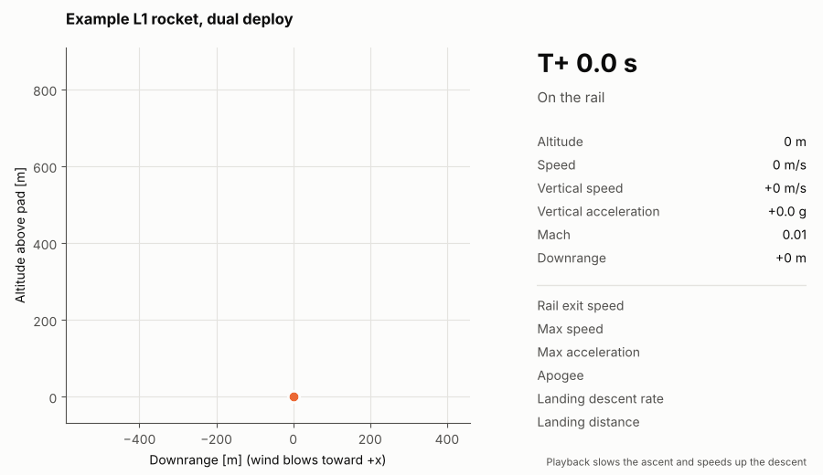
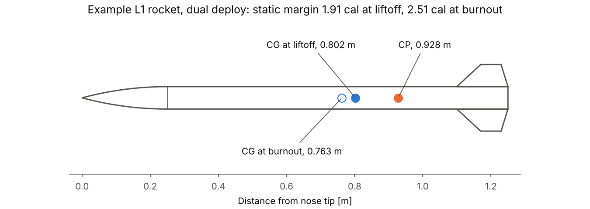
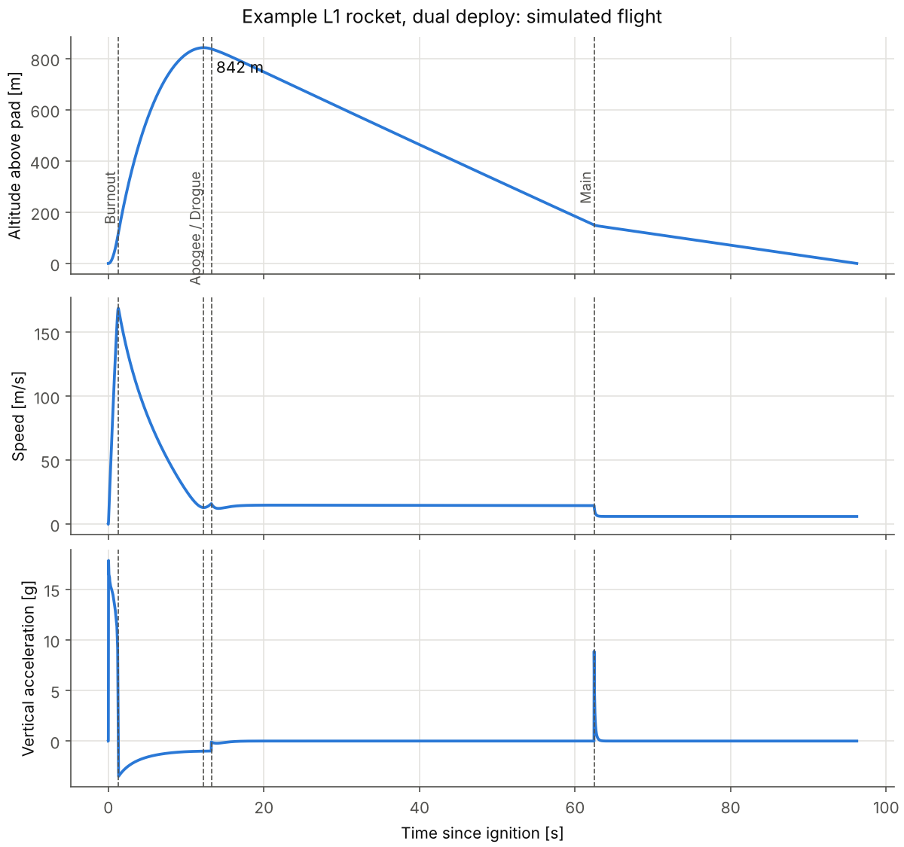
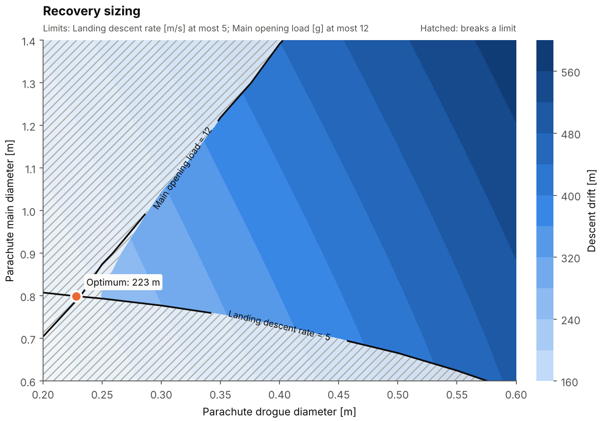
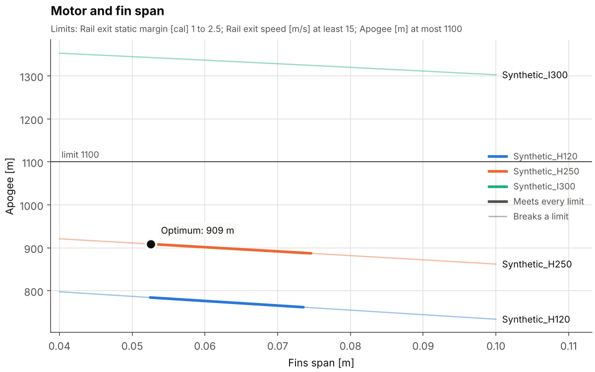

# apogee

[](https://github.com/aroni06/rocket-project/actions/workflows/ci.yml)


**A 2D rocket flight simulator for model and high-power rockets, written in Python.** From a
rocket's geometry, a motor thrust curve and its parachutes, it predicts apogee, max velocity,
acceleration and dynamic pressure, rail exit speed, static margin, parachute deployment
conditions, landing speed and wind drift. It can then sweep any of those inputs or search for the
best design that meets a set of limits: which motor, how much fin, what size parachutes.

> **Status: work in progress.** The flight model, parachute recovery, stability, the design
> optimizer and the flight animation are done, and the physics is checked against closed-form
> solutions and hand calculations. Validation against OpenRocket is next; see the
> [roadmap](#roadmap).







*Example L1 rocket on a synthetic 38 mm H motor, flown dual deploy in a 4 m/s wind: a 0.3 m
drogue opens 1 s after apogee and a 0.9 m main opens at 150 m. The animation slows the ascent
and speeds up the descent so both are watchable.*

## Quickstart

```bash
git clone https://github.com/aroni06/rocket-project.git
cd rocket-project
pip install -e ".[dev]"

apogee simulate configs/example_dual_deploy.toml \
    --plot flight.png --trajectory path.png --drawing rocket.png --animation flight.gif
pytest
```

```
Motor: Synthetic_H250 (H, 260.8 N s, 1.32 s burn)
Drag: estimated from geometry, Cd 0.515 at Mach 0.3 (friction 0.368, base 0.132, fin edges 0.015, nose 0.000)
Flight summary: Example L1 rocket, dual deploy
  Apogee                                   842.17 m
  Max speed                                168.87 m/s
  Max ascent acceleration                   17.83 g
  Rail exit speed                           24.24 m/s
  Rail exit static margin                    1.99 cal
  Drogue descent rate                       13.87 m/s
  Main deploy altitude                     150.00 m
  Main opening load (upper bound)            8.86 g
  Landing descent rate                       4.38 m/s
  Landing downrange                         92.95 m
  ...
Stability: stable, 1.99 cal at rail exit
```

Rockets are defined in TOML: a [single-deploy example](configs/example_l1.toml) using the
motor's ejection charge, and a [dual-deploy example](configs/example_dual_deploy.toml). Each
parachute opens on a trigger plus an optional delay: `apogee`, descending through a set
`altitude`, or `burnout` (a motor ejection delay).

The `[nose]`, `[body]`, `[fins]` and `[[mass]]` sections describe the airframe. Dry mass and
center of gravity are summed from the parts, or you can give measured values with `dry_mass_kg`
and `dry_cg_m`. Drag is one of three things: a `[drag]` table, which estimates the drag
coefficient from the geometry; a constant `cd`; or a `cd_file` CSV of Mach number against drag
coefficient, for example one exported from OpenRocket. Motors are RASP `.eng`
files, the format published by [thrustcurve.org](https://www.thrustcurve.org). The bundled
`Synthetic_*.eng` motors are made-up curves so the examples run out of the box; download real
`.eng` files for real predictions.

From Python:

```python
from apogee import load_config, simulate

cfg = load_config("configs/example_l1.toml")
result = simulate(cfg.rocket, cfg.environment, cfg.rail)
print(result.apogee, result.rail_exit_speed, result.landing_descent_rate)
print(result.static_margin_at("rail_exit"), cfg.rocket.center_of_pressure.position)
```

## Design studies

A study file names the config values that are free to change, one metric to optimize and the
limits a design has to meet. `apogee sweep` flies every design on a grid; `apogee optimize`
searches the ranges continuously and tries every entry of each list.

```toml
# studies/recovery.toml
base = "../configs/example_dual_deploy.toml"

[objective]
metric = "descent_drift_m"     # distance drifted between apogee and landing
goal = "minimize"              # or "maximize", or "target" with a value

[[variable]]
path = "parachute.drogue.diameter_m"
min = 0.20
max = 0.60
steps = 9                      # grid points when swept

[[variable]]
path = "parachute.main.diameter_m"
min = 0.60
max = 1.40
steps = 9

[[constraint]]
metric = "landing_descent_rate_mps"
max = 5.0

[[constraint]]
metric = "main_opening_load_g"
max = 12.0
```

```bash
apogee optimize studies/recovery.toml --plot recovery.png
```

```
Optimum: Recovery sizing (minimize descent_drift_m)
  parachute.drogue.diameter_m               0.2279
  parachute.main.diameter_m                 0.7997
  descent_drift_m                           223.34
  landing_descent_rate_mps                    5.00  (at most 5)
  main_opening_load_g                        12.00  (at most 12)
Limited by
  landing_descent_rate_mps at its maximum of 5
  main_opening_load_g at its maximum of 12
Flights simulated: 105
```



*Smaller parachutes drift less, until the rocket lands too fast or the main opens too hard. The
optimum sits where the two limits cross, and matches a hand calculation from the terminal
velocity formula to 0.3% (it is one of the tests).*

A variable can also be a list of choices, such as motor files.
[`studies/motor_and_fins.toml`](studies/motor_and_fins.toml) picks a motor and a fin span for the
highest flight under a 1100 m field ceiling:

```
Optimum: Motor and fin span (maximize apogee_m)
  motor.file                            Synthetic_H250
  fins.span_m                              0.05253
  apogee_m                                  863.26
  rail_exit_static_margin_cal                 1.00  (1 to 2.5)
  rail_exit_speed_mps                        24.46  (at least 15)
  apogee_m                                  863.26  (at most 1100)
Limited by
  rail_exit_static_margin_cal at its minimum of 1
Best design for each choice
  Synthetic_H250                            863.26
  Synthetic_H120                            752.28
  Synthetic_I300                           1179.43  (breaks a constraint)
Flights simulated: 345
```



*Smaller fins are lighter and have less drag, so every motor flies higher with less fin, until
the static margin drops below 1 caliber. The biggest motor is ruled out because it flies through the ceiling.*

Variables are addressed by their path in the config (`fins.span_m`, `rail.angle_deg`,
`motor.file`, `parachute.main.diameter_m`, `mass.ballast.mass_kg`). Objectives and constraints
can use any number in the flight summary, plus `liftoff_mass_kg`, `descent_drift_m`,
`landing_distance_m` and `min_static_margin_cal`. `apogee sweep study.toml --csv designs.csv`
writes every design and all of its metrics.

The optimizer is SLSQP from SciPy, started from the best few of a Latin hypercube sample, with
variables and constraints scaled to order one and gradients from central differences. Every
flight is cached, so a gradient costs two flights per variable however many constraints there
are. From Python a study can wrap any function, not only a config:

```python
from apogee import Constraint, Objective, Study, Variable

study = Study.from_file("studies/recovery.toml")
best = study.optimize()
print(best.values, best.metrics["descent_drift_m"], best.active)

custom = Study(
    evaluate=my_function,  # dict of values -> dict of metrics
    variables=[Variable("mass_kg", 0.5, 2.0)],
    objective=Objective("apogee_m", "maximize"),
    constraints=[Constraint("rail_exit_speed_mps", lower=15.0)],
)
```

## Model

State `y = [x, z, vx, vz]` in a flat-Earth ground frame (x downrange, z above the pad). Mass is a
known function of time from the motor, so it is not integrated.

$$
m(t)\,\dot{\mathbf v} = T(t)\,\hat{\mathbf u} \;-\; \tfrac12 \rho\, C_D(M)\, A\, |\mathbf v_{air}|\,\mathbf v_{air} \;+\; m\,\mathbf g(h),
\qquad \mathbf v_{air} = \mathbf v - \mathbf v_{wind}
$$

| Piece | Model |
| --- | --- |
| Thrust | RASP thrust curve, linear interpolation |
| Mass | Propellant burns in proportion to delivered impulse: m_p(t) = m_p0 (1 - I(t) / I_total) |
| Atmosphere | 1976 U.S. Standard Atmosphere, 0 to 32 km, launch-site elevation and temperature offset |
| Drag | Estimated from the geometry (below), or a constant C_D, a C_D-vs-Mach table from a CSV file, or any function C_D(Mach) |
| Drag estimate | Turbulent skin friction on the wetted area with a roughness limit and compressibility correction, base drag, fin edge drag by profile, nose pressure drag for cones; depends on Mach and Reynolds number along the flight |
| Center of pressure | Barrowman's equations for the nose cone (conical, ogive, parabolic, elliptical) and trapezoidal fins with fin-body interference |
| Center of gravity | Mass-weighted average of nose, body tube, fins, point masses and the motor; moves forward as propellant burns |
| Static margin | (x_CP - x_CG) / d in calibers, reported at liftoff, rail exit and burnout |
| Gravity | Inverse-square, g = g0 (R / (R + h))^2 |
| Attitude | Along the rail until rail exit, then along the air-relative velocity (zero angle of attack) |
| Wind | Constant horizontal wind |
| Design studies | Grid sweeps over any config values; constrained optimization with multi-start SLSQP over ranges, enumerating lists of choices such as motors |
| Parachutes | Drag 1/2 rho v^2 Cd A per canopy against the air-relative velocity; triggered at apogee, at an altitude, or by motor ejection delay; drogues stay attached after the main opens |

The flight is integrated phase by phase with SciPy's `solve_ivp` (DOP853, adaptive step), and
every discontinuity lands on a step boundary: each thrust-curve corner, rail exit, burnout,
apogee and parachute deployment. Rail exit, apogee, deployment altitudes, landing and the speed
peak are located exactly with event functions rather than read off the nearest time step.

**Deliberately not modelled:** rotational (6-DOF) dynamics, weathercocking on the rail, wind
profiles and gusts, Earth rotation, multi-stage vehicles.

**Known limitations:**

- Barrowman's method assumes subsonic flow and small angles of attack, so the center of
  pressure does not shift with Mach number. One body diameter and one fin set are supported
  (no transitions or boat tails yet).
- The nose cone's own center of gravity defaults to 2/3 of its length from the tip. Weigh and
  balance real parts, or give the whole rocket's measured `dry_cg_m`.
- The drag estimate is subsonic. It has no wave drag, so above about Mach 0.8 it is too low
  and the apogee too high; `apogee simulate` warns when a flight goes that fast. It leaves out
  launch lugs and rail buttons, does not reduce base drag while the motor burns, and assumes a
  fully turbulent boundary layer. It has not been compared with OpenRocket or flight data yet.
- SLSQP is a local optimizer. Several starts guard against local optima, and a sweep of the same
  study is the independent check.
- Parachutes inflate instantly, so the reported opening load is an upper bound on the real
  opening shock.
- The rocket turns into the relative wind the moment it leaves the rail. A real rocket has
  rotational inertia and turns more slowly, so the model overpredicts how far upwind it flies in
  a crosswind (203 m upwind at apogee in the example). OpenRocket comparisons will quantify this.

## Verification

The test suite (`pytest`, run in CI on every push) checks the simulator against cases with a
closed-form answer:

| Case | Compared quantity | Tolerance |
| --- | --- | --- |
| Constant thrust in vacuum | Rail exit time and speed, burnout speed and altitude, apogee (rocket equation with gravity) | 1e-7 relative |
| Vertical coast with quadratic drag | Apogee, time to apogee, landing speed | 1e-7 relative |
| Drag-free projectile at 45 degrees | Range, apogee, landing speed | 1e-7 relative |
| Ballistic arc, inverse-square gravity | Specific energy conserved | 1e-8 relative |
| Solver tolerance 1e-6 vs 1e-11 | Apogee and max speed | 1e-5 relative |
| Standard atmosphere | T, p, rho at 0, 1, 5, 11 and 20 km vs 1976 tables | 1e-4 relative |
| Fall under a parachute from apogee | Landing descent rate vs the closed-form quadratic-drag solution | 1e-6 relative |
| Drogue, then drogue plus main | Steady descent rates vs terminal velocity sqrt(2mg / rho Cd A) | 1e-3 relative |
| Deployment triggers | Apogee + delay, set altitude, burnout + ejection delay | exact event times |
| Descent in wind | Horizontal speed under canopy settles at wind speed | 1e-3 relative |
| Barrowman center of pressure | Fin normal-force slope, fin and nose CP, total CP vs a hand calculation | 1e-5 relative |
| Center of gravity | Component sum, motor at mid-length, forward shift during the burn | exact |
| Skin friction | Smooth turbulent law vs the Prandtl-Schlichting flat-plate formula, Re 1e5 to 1e9 | 4% |
| Drag estimate | Each component and the total vs a hand calculation; nose wetted area vs cone and hemisphere formulas | 1e-6 relative |
| Drag in flight | Recorded drag vs q C_D A with C_D at the local Mach and Reynolds number | 1e-9 relative |
| Optimizer, analytic problems | Constrained minimum of a quadratic, a variable at its bound, a target value, an infeasible problem | 1e-4 absolute or better |
| Optimizer, best coasting mass | Mass that coasts highest for a fixed impulse with quadratic drag vs the closed-form optimum | 1e-6 relative in apogee |
| Optimizer, recovery sizing | Drogue and main diameters vs hand sizing from terminal velocity and the opening-load ratio | 2e-3 and 5e-3 relative |
| Sweep | Grid points vs single flights; best grid point never beats the optimizer | 1e-8 relative |

Comparison against OpenRocket on real rocket designs comes with milestone 5.

## Project layout

```
src/apogee/
  atmosphere.py    standard atmosphere
  motor.py         .eng parser, thrust(t), mass(t)
  rocket.py        rocket definition, CG through the burn, static margin
  environment.py   gravity, wind, launch site
  recovery.py      parachutes, deployment triggers, terminal velocity
  components.py    nose cone, body tube, fins, point masses, dry mass and CG
  aero.py          Barrowman center of pressure, drag estimate, Cd-vs-Mach tables
  flight.py        equations of motion, phases, events, FlightResult
  study.py         design studies: sweeps, constraints, optimizer
  config.py        TOML loader
  plots.py         flight, rocket and design-space plots
  animation.py     animated flight path with a live readout (GIF)
  cli.py           `apogee simulate`, `apogee sweep`, `apogee optimize`
configs/           example rockets
studies/           example design studies
data/motors/       thrust curves (synthetic, for the examples)
tests/             unit and analytic verification tests
```

## Roadmap

- [x] 1. Repo skeleton, packaging, CI
- [x] 2. Core 2D flight model with analytic verification
- [x] 3. Recovery: single and dual deploy, landing speed, wind drift
- [x] 4. Aerodynamics and stability: C_D(Mach) import, Barrowman CP, CG, static margin
- [ ] 5. Validation against OpenRocket on 2 to 3 rockets
- [x] 6. Parameter sweeps and constrained design optimizer
- [x] 7. Flight animation
- [x] 8. Drag estimated from the geometry
- [ ] 9. Technical report and v1.0
- [ ] 10. After v1.0: liquid and hybrid engines with throttling

## License

MIT
