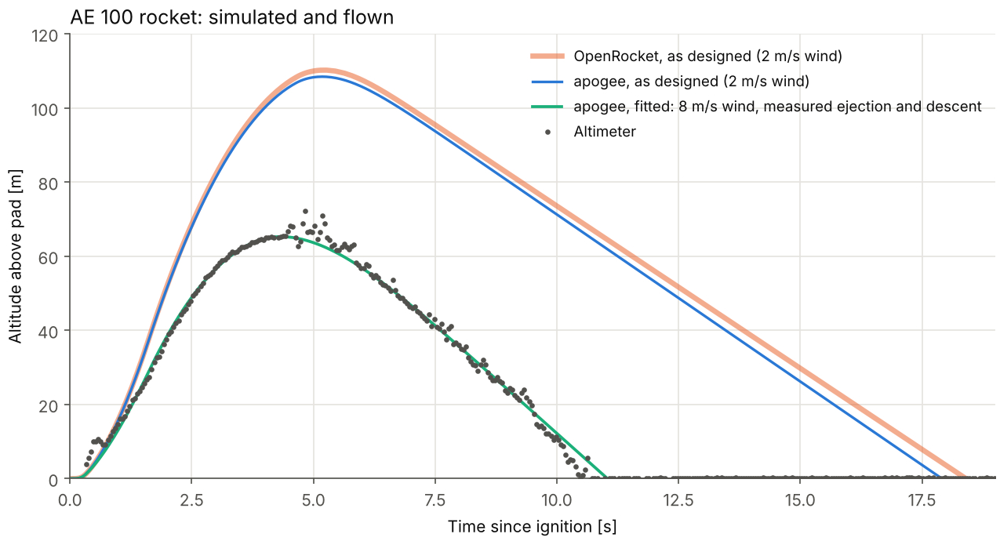
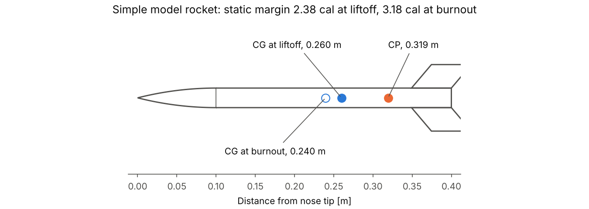
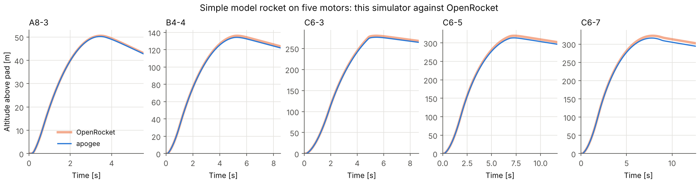

# Validation

The tests in `tests/` check the simulator against problems with a closed-form answer. This
folder checks it against two things that are not arithmetic: OpenRocket, the simulator most of
the hobby uses, and a real flight.

Each case is a folder holding an OpenRocket design saved with its simulation data (`.ork`), the
same rocket written by hand as an `apogee` config, and the motor files. Every number in the
config is read off the design. Nothing is adjusted to make the results agree.

```bash
apogee compare validation/ae100/config.toml validation/ae100/ae100.ork --plot comparison.png
```

## Summary

Two rockets, six flights, apogees from 50 m to 320 m, all in OpenRocket's default 2 m/s wind.

| Rocket | Motor | apogee [m] | OpenRocket [m] | Apogee | Top speed | Drag coefficient |
| --- | --- | ---: | ---: | ---: | ---: | ---: |
| AE 100 rocket | D12-3 | 107.5 | 110.2 | -2.4% | +0.2% | -0.5% |
| Simple model rocket | A8-3 | 50.3 | 50.6 | -0.6% | -0.1% | +0.4% |
| | B4-4 | 134.3 | 136.2 | -1.4% | -0.2% | +2.6% |
| | C6-3 | 276.6 | 280.2 | -1.3% | -0.4% | +1.5% |
| | C6-5 | 313.8 | 319.5 | -1.8% | -0.4% | +1.5% |
| | C6-7 | 316.5 | 322.8 | -1.9% | -0.4% | +1.5% |

Mass, center of gravity, center of pressure and rail exit speed agree within 1% on every flight
(center of pressure within 2% on the A8, where OpenRocket's rocket is still flying at an angle
at its top speed). The apogee is 0.6% to 2.4% low every time, and the reason is the same every
time: this simulator turns the rocket into the wind instantly, so it also ends up 60% to 90%
further upwind than OpenRocket's. That is the model's largest known error, and it is the next
thing a pitch degree of freedom would fix.

## AE 100 rocket

A 46 cm, 300 g model rocket on an Estes D12-3: an elliptical nose cone wider than the body tube,
a short transition down to the tube, three small fins and a 30 cm parachute. It is a useful first
case because it is awkward. The static margin is about one caliber, it leaves a 1 m rod at only
12 m/s, and the nose-to-body transition takes a third of the normal force away from the nose.


### Against OpenRocket

OpenRocket's own simulation used a 1 m rod, 2 m/s wind and a standard atmosphere at sea level, so
the config does too.

| | apogee | OpenRocket | difference |
| --- | ---: | ---: | ---: |
| Liftoff mass [kg] | 0.2997 | 0.300 | -0.1% |
| Burnout mass [kg] | 0.2786 | 0.279 | -0.1% |
| CG at liftoff [m] | 0.1596 | 0.160 | -0.2% |
| CG at burnout [m] | 0.1395 | 0.139 | +0.3% |
| Center of pressure [m] | 0.2150 | 0.213 | +0.9% |
| Drag coefficient at top speed | 0.281 | 0.282 | -0.5% |
| Rail exit speed [m/s] | 11.92 | 11.91 | +0.1% |
| Maximum speed [m/s] | 40.60 | 40.50 | +0.2% |
| Burnout altitude [m] | 38.51 | 38.93 | -1.1% |
| **Apogee [m]** | **107.5** | **110.2** | **-2.4%** |
| Time to apogee [s] | 5.16 | 5.28 | -2.2% |
| Sideways distance at apogee [m] | 34.0 | 18.5 | +84% |
| Descent rate at landing [m/s] | 8.68 | 8.74 | -0.6% |
| Flight time [s] | 18.19 | 18.40 | -1.1% |


OpenRocket reports the rail exit speed at its first time step past the rod (12.03 m/s here).
The table interpolates its data to the end of the rod so both columns mean the same thing.

**What agrees.** The inputs to the flight agree to better than 1%: the mass and its balance
point, the center of pressure from Barrowman's equations including the transition, and the drag
coefficient, which stays within 2% of OpenRocket's from liftoff to ejection. OpenRocket splits
its drag into friction, pressure and base drag; the last two match to three decimal places
(0.080 and 0.060). The flight follows: top speed within 0.2%, descent rate within 1%.

**What does not, and why.** The apogee is 2.4% low and the rocket ends up nearly twice as far
upwind. Both come from one simplification. This simulator has no rotation: the rocket points
into the relative wind the instant it leaves the rod. OpenRocket's rocket has inertia, turns
over a fraction of a second while it is still accelerating, and so tilts less. With the wind
set to zero this simulator reaches 112.1 m, so a 2 m/s wind costs it 4.6 m. If OpenRocket's
calm-air apogee is about the same, that wind costs OpenRocket about 2 m. The error grows with
the wind and with a slow rail exit, and 12 m/s is a slow rail exit.

### Against the real flight

The rocket flew with a PerfectFlite Pnut barometric altimeter on a hot, windy day. It reached
212 ft (65 m) where both simulators predict about 110 m, and came down at 12.5 m/s where they
predict 9. The wind was not measured.

```bash
python validation/ae100/flight.py --plot flight.png
```



The script asks what would have to be true for the simulator to reproduce the altimeter, at the
real site elevation (436 ft) and temperature (88 F, read from the altimeter):

| | Fitted | Design value |
| --- | ---: | ---: |
| Wind | 8.2 m/s (18 mph) | 2 m/s |
| Ejection delay | 2.6 s | 3 s |
| Parachute drag coefficient | 0.41 | 0.8 |

With an 8.2 m/s wind the simulated climb follows the altimeter within 0.8 m RMS from half a
second after launch to ejection, and predicts a top vertical speed of 29 m/s against the
altimeter's own estimate of 26.5. A wind of that strength is consistent with the day: a rocket
leaving the rod at 12 m/s into an 8 m/s crosswind turns about 35 degrees off vertical at once,
and gravity keeps bending a tilted path further over for the rest of the burn.

How far to trust that number:

- **The climb alone cannot tell wind from weight.** No wind and a rocket 79 g (26%) heavier than
  the design fits the altimeter equally well. What rules that out is outside the data: the
  masses in the design are the rocket's measured ones, confirmed by its builder. That leaves
  the wind.
- **The instant turn overstates the effect of wind**, as the OpenRocket comparison shows, so the
  real wind was probably somewhat stronger than 8 m/s if wind was the whole story. On the other
  hand a rocket with one caliber of margin at 35 degrees angle of attack is far outside the
  small-angle aerodynamics both simulators assume, and may have lost more than either predicts.
- **The altimeter reads low in hot air.** It converts pressure to altitude with a standard
  atmosphere, and at 31 C a metre of climb changes the pressure 5.6% less. The 65 m it
  recorded was about 69 m. The script converts the simulation to what the altimeter would
  read before comparing.
- **The descent is a separate problem.** Whatever the wind, the rocket came down 40% faster
  than a fully open 30 cm parachute with a drag coefficient of 0.8 allows. With the mass
  confirmed, the parachute was delivering about half its design drag: partly open, tangled,
  or spilling air in the wind.

The files: `ae100.ork` is the OpenRocket design with its simulation, `config.toml` the same
rocket for this simulator, `Estes_D12.eng` the motor (NAR certification data, from
thrustcurve.org), `altimeter.csv` the flight data with the altimeter's serial number removed.

## Simple model rocket

"A simple model rocket" is the example design that ships with OpenRocket (designed by Sampo
Niskanen, OpenRocket's author): a 40 cm, 25 mm rocket with an ogive nose, three swept fins, a
launch lug and a 30 cm parachute. Its file holds five motor configurations and a simulation of
each, so one design gives five flights that differ sixfold in apogee. Anyone with OpenRocket
can open the same example and check these numbers.



```bash
python validation/simple_model_rocket/compare.py --plot comparison.png
apogee compare validation/simple_model_rocket/config.toml \
    validation/simple_model_rocket/simple_model_rocket.ork --simulation 4
```

| Difference from OpenRocket | A8-3 | B4-4 | C6-3 | C6-5 | C6-7 |
| --- | ---: | ---: | ---: | ---: | ---: |
| Liftoff mass | -0.7% | +0.2% | +0.5% | +0.5% | +0.5% |
| CG at liftoff | 0.0% | 0.0% | 0.0% | 0.0% | 0.0% |
| Center of pressure | +1.7% | +0.4% | +0.1% | -0.2% | -0.2% |
| Drag coefficient at top speed | +0.4% | +2.6% | +1.5% | +1.5% | +1.5% |
| Rail exit speed | 0.0% | -0.1% | 0.0% | 0.0% | 0.0% |
| Maximum speed | -0.1% | -0.2% | -0.4% | -0.4% | -0.4% |
| **Apogee** | **-0.6%** | **-1.4%** | **-1.3%** | **-1.8%** | **-1.9%** |
| Time to apogee | -0.8% | -0.4% | +0.6% | -0.7% | -1.5% |
| Descent rate at landing | +0.4% | +0.3% | -0.3% | -1.5% | -0.9% |



**The masses are computed, not copied.** This design gives no masses: OpenRocket works each one
out from the part's dimensions and its material's density. The config does the same sum (a 2 mm
polystyrene nose shell with its shoulder, a 1 mm cardboard tube, and so on) and arrives at a dry
mass of 48.22 g, against 48.1 to 48.3 g recovered from OpenRocket's data, with the center of
gravity matching to the millimetre on all three motors. OpenRocket stores the mass rounded to
the gram, which is 1.5% of this rocket, so the mass row above is mostly that rounding.

**The motors.** `Estes_C6.eng` is the published NAR certification curve and is exactly what
OpenRocket flew (its thrust samples sit within 0.02 N RMS of the file). OpenRocket's A8 and B4
curves are different data sets from the published files at hand, so `make_motors.py` rebuilds
them from the thrust and motor-mass columns of the stored simulations. Applied to the C6, where
the answer is known, that method returns the published impulse within 0.1% and both masses
within 0.02 g.

**The launch lug.** Without it the drag coefficient was 3.8% below OpenRocket's and the apogee
0.3% above: two errors cancelling. The lug is now in the drag estimate as the stagnation
pressure on the tube's wall area (0.033 here, where OpenRocket's more detailed model gives 0.025
to 0.030), which puts the drag coefficient 1.5% above OpenRocket's and exposes the real apogee
difference. Of the 1.8% on the C6-5, about 1.5% is the turn into the wind (in still air this
simulator reaches 318.7 m, 4.9 m higher) and the rest is the slightly higher drag.

The files: `simple_model_rocket.ork` is OpenRocket's example design, unchanged, saved with its
simulations from OpenRocket 23.09 (OpenRocket is distributed under the GNU GPL).
`config.toml` is the default C6-5 configuration; `compare.py` swaps the motor and delay for
the other four.
